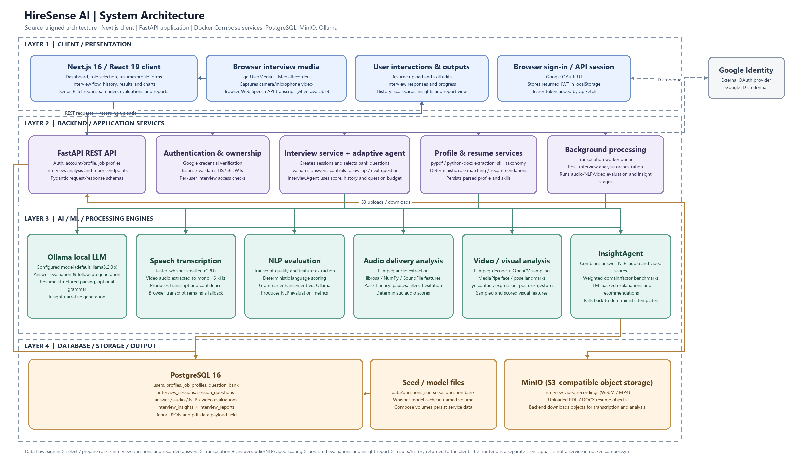

# HireSense AI — Adaptive Multi-Modal Mock Interview Platform

HireSense AI is an enterprise-grade AI mock interview platform that simulates realistic technical and behavioral interviews. It leverages real-time multi-modal analysis across verbal content, vocal delivery, and visual body language to provide actionable, objective candidate feedback.



---

## Key Features

- **Adaptive Questioning**: State machine agent tracks competency coverage and dynamically asks follow-up questions to probe candidate responses.
- **Visual & Body Language Analysis**: Powered by MediaPipe FaceMesh (iris-level eye contact tracking) and Pose estimation (posture stability, head movements, and gesture analysis).
- **Vocal & Prosody Analysis**: Measures words per minute (WPM), speech cadence, pauses, pitch variation, and hesitation/fillers using FFmpeg, Librosa, and SciPy.
- **Accurate Speech-to-Text**: Low-latency browser WebSpeech live drafts reconciled with asynchronous background `faster-whisper` (`int8` quantized model on CPU).
- **Linguistic & Code-Switching Insights**: Analyzes vocabulary, grammar, and bilingual code-switching (e.g., English and Hindi).
- **Comprehensive Candidate Reports**: Multi-dimensional scoring, radar charts, question-by-question playback, and exportable PDF feedback summaries.
- **Enterprise Design System**: Modern Slate & Cobalt dark theme with responsive navigation and skeleton loaders.

---

## Architecture & Tech Stack

### Frontend
- **Framework**: Next.js 16 (App Router, Turbopack)
- **UI & Components**: React 19, Tailwind CSS v4, Lucide React
- **Data Visualization**: Recharts (Radar charts, performance breakdown)
- **Authentication**: Google OAuth 2.0 with JWT session tokens

### Backend
- **Framework**: FastAPI (Python 3.12, Uvicorn)
- **ORM & Database**: SQLAlchemy 2.0, PostgreSQL 16
- **Object Storage**: MinIO (S3-compatible storage for videos and resumes)
- **Local LLM**: Ollama (`llama3.2:3b`) for follow-up question generation and insight synthesis
- **Speech Recognition**: `faster-whisper` (`small.en` / multilingual)
- **Computer Vision**: MediaPipe FaceMesh & Pose (OpenCV headless)
- **Audio Processing**: Librosa, SciPy, SoundFile, FFmpeg
- **Document Parsing**: PyPDF, python-docx for resume competency extraction

---

## Service Endpoints

| Service | Port / URL | Description |
| :--- | :--- | :--- |
| **Frontend** | `http://localhost:3000` | Next.js Web Application |
| **Backend API** | `http://localhost:8000` | FastAPI Application |
| **Interactive Docs** | `http://localhost:8000/docs` | Swagger / OpenAPI UI |
| **PostgreSQL** | `localhost:5432` | Relational Database |
| **MinIO Console** | `http://localhost:9001` | Object Storage Web UI (Port 9000 API) |
| **Ollama** | `http://localhost:11434` | Local LLM Server |

---

## Getting Started

### Prerequisites
- [Docker](https://www.docker.com/) & Docker Compose
- [Node.js](https://nodejs.org/) (v20+ recommended)
- [Python 3.12](https://www.python.org/) (if running backend outside Docker)

### 1. Environment Configuration

Copy the example environment files:

```bash
# Root environment (Backend & Services)
cp .env.example .env

# Frontend environment
cp frontend/.env.local.example frontend/.env.local
```

Configure your `GOOGLE_CLIENT_ID` and `JWT_SECRET` in `.env` and `frontend/.env.local`.

### 2. Launch Backend Services with Docker Compose

Start PostgreSQL, MinIO, Ollama, and the FastAPI backend:

```bash
docker compose up -d
```

Pull the local LLM model into Ollama (if not already downloaded):

```bash
docker exec -it hiresense-ollama ollama pull llama3.2:3b
```

### 3. Start the Next.js Frontend

```bash
cd frontend
npm install
npm run dev
```

Open [http://localhost:3000](http://localhost:3000) in your browser.

---

## Project Structure

```
HireSense-AI/
├── backend/
│   ├── app/
│   │   ├── agents/          # Interview state machine & Insight synthesis agents
│   │   ├── db/              # SQLAlchemy database configuration
│   │   ├── models/          # Relational data models
│   │   ├── routes/          # API endpoints (Auth, Account, Interviews)
│   │   ├── schemas/         # Pydantic request/response schemas
│   │   ├── seed/            # Database initializers & seed data
│   │   ├── services/        # Video, audio, NLP, transcription, & storage services
│   │   └── main.py          # FastAPI application entrypoint
│   ├── Dockerfile
│   └── requirements.txt
├── data/
│   └── questions.json       # 300+ categorized competency & technical questions
├── docker/                  # Database migration scripts & volume configurations
├── frontend/
│   ├── app/                 # Next.js App Router (Interview, Results, History, Resume)
│   ├── components/          # Reusable UI components & layouts
│   ├── lib/                 # Auth context, API utilities, and config
│   └── package.json
├── docker-compose.yml       # Container orchestration
├── PROGRESS.md              # Milestone tracking & verification status
└── TRANSCRIPTION.md         # Transcription pipeline technical guide
```

---

## License

This project is licensed under the MIT License.
